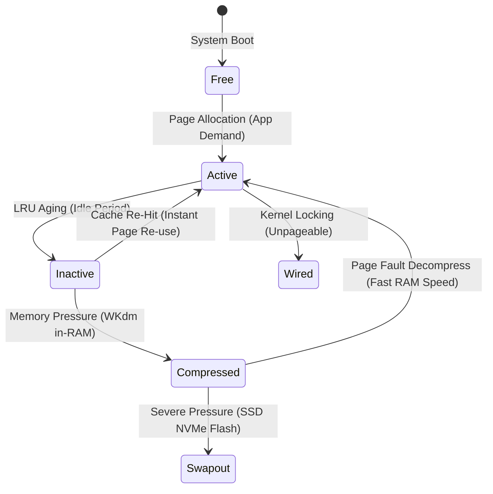

# The Mathematics of Mach Virtual Memory: Page Replacement & In-RAM Compression 🧠📊

> **Author**: Machina Telemetry Research Group  
> **Topic**: Operating Systems, Virtual Memory, Paging, In-Memory Compression  
> **Keywords**: Mach Kernel, Virtual Memory, Active vs Inactive Pages, Memory Pressure, WKdm Compression, SSD Wear Leveling  

---

## 1. The Myth of "Free RAM"

A pervasive misconception among computer users is that "good" performance requires hundreds of megabytes or gigabytes of **Free RAM**.

From a systems engineering standpoint, **Free RAM is wasted silicon and wasted energy**. Unused memory draws electricity just sitting idle. A modern operating system treats memory as a dynamic cache for the filesystem and active applications.

In macOS (which runs on the Mach $3.0$ virtual memory subsystem), memory is structured not as a binary "used vs free" state, but as a multi-stage state machine:

---

## 2. Mathematical Decomposition of Mach Page States

On macOS, memory pages have a native geometry of **$16,384\text{ bytes}$ ($16\text{ KB}$)**, four times larger than the classic x86 $4\text{ KB}$ page size. This reduces the size of the page table by $75\%$ and drastically improves the hit rate of the hardware **Translation Lookaside Buffer (TLB)**.

The total physical memory $M_{\text{total}}$ is decomposed into:

$$M_{\text{total}} = M_{\text{wired}} + M_{\text{active}} + M_{\text{inactive}} + M_{\text{compressed}} + M_{\text{free}}$$

Where:
* **$M_{\text{wired}}$**: Memory strictly locked into physical RAM. It contains kernel data structures, page tables, framebuffers, and interrupt handlers that must never be paged out.
* **$M_{\text{active}}$**: Memory pages currently referenced and touched by running user-space processes within the last sampling interval.
* **$M_{\text{inactive}}$**: Pages that were recently used but are no longer actively referenced. Crucially, **inactive memory acts as an ultra-high-speed disk cache**. If the application needs that data again, it is re-activated in less than $0.1\text{ microseconds}$ without any disk I/O.
* **$M_{\text{compressed}}$**: Dormant memory compressed in-place inside RAM using hardware-accelerated algorithms.
* **$M_{\text{free}}$**: Truly unallocated physical page frames available for immediate zero-filling.

---

## 3. The Mathematics of In-Memory Compression

When applications request additional memory and $M_{\text{free}}$ drops below a critical threshold $\tau_{\text{crit}}$, traditional operating systems page out memory directly to disk (swapfile):

$$\text{Disk Swap Penalty} \approx 25,000\text{–}100,000\text{ ns}$$

Apple's Mach VM implements a sophisticated **In-Memory Compressor** (based on a variant of the WKdm algorithm) that achieves a typical compression ratio of:

$$C_r = \frac{\text{Uncompressed Size}}{\text{Compressed Size}} \approx 2.5 : 1 \text{ to } 4.0 : 1$$

Instead of wearing out SSD flash memory with write amplification and incurring huge disk latency penalties, macOS compresses idle pages in RAM at speeds exceeding **$30\text{ GB/s}$**!

$$\text{Compression Latency} \approx 100\text{–}200\text{ ns} \quad (\mathbf{250\times} \text{ faster than SSD swap!})$$

---

## 4. Why Memory Pressure is the True Metric of Health

Because macOS intentionally fills RAM with file caches, reading the "Free RAM" metric is meaningless. Instead, telemetry monitors compute the **Memory Pressure Metric**:

$$\text{Memory Pressure} = \frac{M_{\text{wired}} + M_{\text{compressed}} + \alpha \cdot \text{Paging Rate}}{M_{\text{total}}}$$

* **Normal (Green)**: Memory pages are comfortably circulating between active and inactive caches. Zero disk swapping.
* **Moderate (Yellow)**: The kernel compressor is actively compacting idle pages. Minor degradation, but zero disk thrashing.
* **Critical (Red)**: The in-RAM compressor is fully saturated; pages must be evicted to physical disk swap on the NVMe drive.
